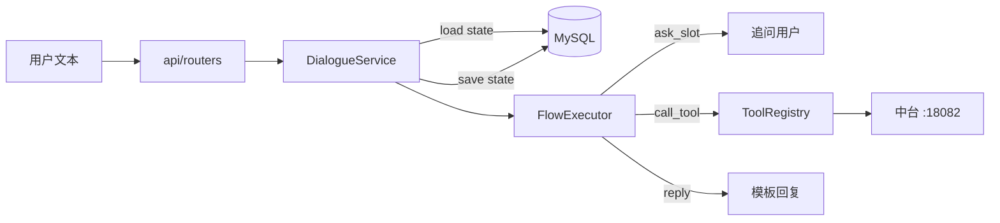

# Day 00 - 课程导读：DeviceCare Agent 怎么讲、讲到哪、和电商小二差在哪

> 适用：给别人的项目课 / 自己复盘 / 面试讲项目。
> 事实基线：`F:\AAA求职相关\device_agent\执行盘点与验收记录.md`（以运行证据为准）。

---

## 1. 这门课要解决什么

**一句话**：用户描述设备故障 → 系统收槽、查保修、建工单、查进度、转人工；LLM 只做理解，流程引擎管确定性业务，中台管写入事实。

和电商小二对照：

| 维度 | 电商小二 | DeviceCare Agent |
|---|---|---|
| 业务域 | 订单 / 退款 / 物流 | 设备 / 保修 / 维修工单 / 转人工 |
| 业务基座 | ecommerce-service-backend | device-service-backend :18082 |
| Agent 网关 | customer-service-backend / atguigu | atgui_agent / agent_gateway |
| 流程定义 | flow_config/*.yml | flow_config/*.yml |
| 状态中枢 | DialogueState | DialogueState（同构思想） |
| 流程引擎 | FlowExecutor + 节点-边 DAG | FlowExecutor + **线性 next**（见 Day 03） |
| 规划 | TurnPlanner + Validator（LLM） | 确定性关键词路由（M2 再上 LLM） |

---

## 2. 进度地图（做到哪一步）

```text
✅ 已完成（有测试）
   ├─ 领域模型 messages / contexts / state
   ├─ YAML 定义模型 task/models.py（加载校验）
   ├─ 工具注册表 task/tools.py
   ├─ FlowExecutor 多轮推进（保修收槽→查→回）
   └─ API /health /api/chat /api/chat/history（15 tests）

🚧 进行中 / 下一步
   ├─ 报修 confirm 全链
   ├─ 进度查询 + 归属校验
   ├─ 插话后恢复原任务（压栈已有，弹回未完）
   └─ 中台确认令牌 + 幂等 + 唯一工单号

⬜ 计划中（未做，禁止讲课时说“已实现”）
   ├─ TurnPlanner + Validator（M2）
   ├─ RAG 真实引用链
   ├─ LangGraph 多 Agent / 标准 MCP（M3，可选）
   └─ 评测集 evals/cases.jsonl
```

**讲课纪律**：上表就是你的诚实边界。演示只跑绿的场景。

---

## 3. 建议授课顺序（对齐电商小二 Day 编号）

| 本项目讲义 | 对齐电商小二 | 核心问题 | 对应代码 |
|---|---|---|---|
| [01_架构全景](01_架构全景.md) | Day01 | 为什么要拆中台 / 网关 / 前端？ | 整仓 |
| [02_对话状态中枢](02_对话状态中枢.md) | Day02 | 多轮任务存在哪？插话怎么办？ | `domain/state.py` `contexts.py` |
| [03_YAML流程定义](03_YAML流程定义_节点与边.md) | Day03 | 流程怎么声明？**节点挂边 vs 线性 next** | `task/models.py` `flow_config/*.yml` |
| [04_FlowExecutor推进](04_FlowExecutor推进.md) | Day04 | 谁在推状态机？工具怎么调？ | `engine/flow_executor.py` `task/tools.py` |
| [05_API与前后端联调](05_API与前后端联调.md) | Day13-14 | HTTP 边界、落库、前端能测什么 | `api/` `service/` `device-service-frontend` |
| [06_语义理解与安全闸门](06_语义理解与安全闸门.md) | Day07-10 | 口语确认/取消、归属、写操作边界 | `flow_executor` `tools`（LLM 规划 = M2） |

---

## 4. 三种「怎么把项目讲清楚」的图

### 4.1 一条消息的调用链



### 4.2 定义侧 vs 运行时（最容易讲混的点）

```text
flow_config/*.yml     「图纸」——步骤、话术、工具名
        ↓ load_catalog()
task/models.py        「图纸对象」——Flow / FlowStep / FlowSlot
        ↓ FlowExecutor.handle(state, text)
domain/state.py       「施工进度」——TaskContext(flow_id, step_id, slots)
```

**讲课口诀**：YAML 是图纸，models 是图纸的类型化，TaskContext 是施工进度，Executor 是施工队长。

### 4.3 本课不讲什么

- 不讲「我们已经接了 LangGraph」——没有。
- 不讲「YAML 里的 `confirmed: true` 就是安全确认」——中台还没做令牌。
- 不把电商小二的订单代码当成设备项目的代码——只借思想。

---

## 5. 开场 60 秒话术（可直接用）

> 我做的是设备售后协同智能体。用户说「帮我报修」，系统按 YAML 流程收设备号、故障类型，用户确认后才写工单。  
> 架构上业务事实放在中台，Agent 网关只做对话与流程编排；写操作有 confirm 步骤闸门。  
> 流程引擎把「可枚举业务」从 LLM 手里拿出来，用声明式 YAML 描述、状态机推进——和 Rasa / 工作流引擎同一思想。  
> 目前保修多轮已经跑通并有测试；报修确认链和中台幂等是下一步。  

---

## 6. 灵魂拷问（课后自测）

1. 为什么流程写在 YAML 而不是 Python if-else？
2. `TaskContext.step_id` 存的是什么？重启后怎么恢复？
3. 为什么 `confirmed: true` 写在 YAML 里**不能**代替服务端确认？
4. 本项目的 `next: xxx` 和电商小二的 `FlowStepLink` 差在哪？（见 Day 03）
5. LLM 在本项目里该干什么、不该干什么？

### 参考答案

**1. 为什么流程写在 YAML 而不是 Python if-else？**  
可枚举业务（收槽 → 查 → 确认 → 写）步骤固定，改的是文案、顺序、工具名，不是算法。写进 if-else 则每次改需求都要发版；YAML 让产品/实施改配置即可，代码只有一套通用 `FlowExecutor`。加载期校验还能把写错的 next / 未知工具提前炸掉。

**2. `TaskContext.step_id` 存的是什么？重启后怎么恢复？**  
存「当前流程停在哪个步骤 id」（如 `ask_device_id`），配合 `flow_id` + `slots` 构成施工进度。重启后 `DialogueService._load` 从仓储 `from_dict` 还原 `DialogueState`，`FlowExecutor` 按 `flow_id` 查定义、从 `step_id` 继续推进。**前提是状态已 save；且状态与消息最好同事务（P1）**。

**3. 为什么 YAML 里 `confirmed: true` 不能代替服务端确认？**  
那是**流程配置字段**，表示「走到这步时假定用户已同意」。客户端/配置都能写 true，等于自说自话。真实授权必须由中台签发绑定 **会话 + 资源 + 参数摘要 + 有效期** 的一次性 `confirmation_id`，用户明确确认后才能消耗。YAML 字段最多当过渡提示。

**4. `next: xxx` 和 `FlowStepLink` 差在哪？**  
我们是线性字符串：`next: query_warranty` 或 `next: end`，图近似链表。电商小二是边对象列表：`StaticLink` / `ConditionalLink` / `FallbackLink`，可表达 if/else 分支 DAG。业务还没分支时链表更简单；要分支时再把 `next` 扩成 `str | list[Link]`，旧写法兼容成 StaticLink。

**5. LLM 该干什么、不该干什么？**  
**该**：理解自然语言、抽取槽位草稿、M2 里出受限 TurnPlan（route/flow_id/slots）。  
**不该**：直接定任意工具名/URL/写参数、自算保修日期、编造手册引用、在未确认时执行写操作。确定性流程与安全闸门必须在代码/中台，不靠 prompt 保证。
