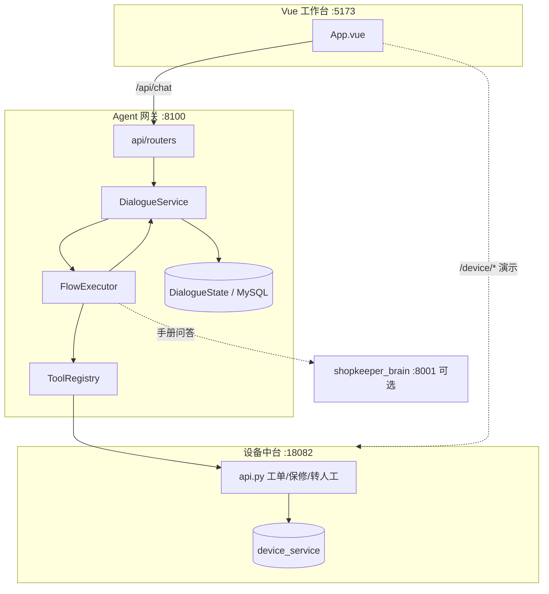
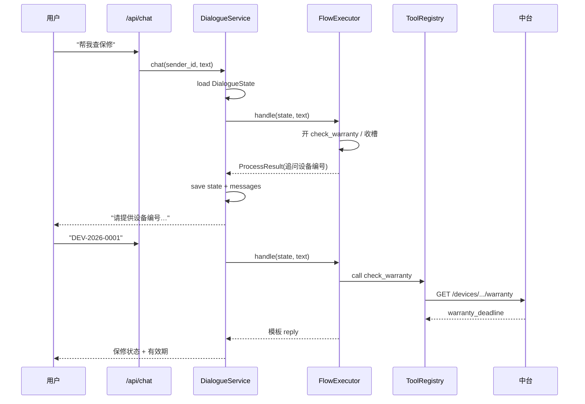

# Day 01 - 架构全景：为什么拆成「业务中台 + Agent 网关 + 工作台」

---

## 1. 任务目标

### 1.1 本章目标

读完应能白板讲清：

1. 为什么**设备/工单事实**放中台，**对话/流程**放 Agent 网关，不在一个进程里糊；
2. 为什么 99% 的 Agent 代码在做「把不确定性关进笼子」；
3. 目录里每个文件夹是干什么的，新人该从哪读起。

### 1.2 涉及文件 / 目录

| 路径 | 角色 |
|---|---|
| `device-service-backend/` | 业务中台：设备、保修、工单、转人工 REST |
| `mysql/initdb/` | 业务库初始化 SQL |
| `atgui_agent/agent_gateway/` | Agent 网关：对话、状态、流程、工具 |
| `atgui_agent/flow_config/` | 流程 YAML（改文案不改代码） |
| `atgui_agent/device-service-frontend/` | Vue 工作台 :5173 |
| `atgui_agent/docker-compose.yml` | 只编排 MySQL + 中台（不含 Agent） |
| 根 `启动说明.txt` | **唯一权威启动入口** |

---

## 2. 核心概念桥接

| AI 对话术语 | 后端工程师对照 | 一句话 |
|---|---|---|
| Agent 网关 | BFF / 编排层 | 只做对话事务，不持有业务事实 |
| 业务中台 | 领域服务 + DB | 设备/工单的唯一真相与写入权威 |
| FlowExecutor | 状态机解释器 | 沿 YAML 推进任务 |
| ToolRegistry | 防腐层 / 适配器 | 固定端点调中台，禁止任意 URL |
| DialogueState | 会话聚合根 | 一个用户一份完整任务记忆 |

---

## 3. 需求分析

### 3.1 反例：全部塞进一个服务

```python
# 反例：Agent 进程里直接写工单表
def handle_chat(text):
    if "报修" in text:
        db.insert_ticket(...)   # 谁校验归属？谁防重放？
```

问题：对话逻辑和业务事实耦合；无法单独审计写入；前端直连 DB 风险高。

### 3.2 正解：三条硬边界

```text
RAG 找证据  |  Agent 决策过程  |  中台执行业务
```

- **读**：Agent 调中台 `GET /devices/{id}/warranty`
- **写**：必须 confirm 流程步骤 + 中台服务端确认（P1 补令牌）
- **知识**：RAG 可选；不可用时显式降级，禁止假引用

---

## 4. 架构图



### 4.1 一条消息的时序



---

## 5. 目录导读（新人 30 分钟路径）

```text
1. 根 启动说明.txt          ← 怎么跑起来
2. flow_config/user_flows.yml ← 业务长什么样（先读这个！）
3. domain/state.py          ← 多轮记什么
4. task/models.py           ← YAML 如何变成对象
5. engine/flow_executor.py  ← 谁在推进
6. task/tools.py            ← 如何调中台
7. api/routers.py           ← HTTP 边界
```

---

## 6. 架构决策记录（讲课必答）

| 决策 | 为什么 | 否决的方案 |
|---|---|---|
| 中台与网关分进程 | 写入权威独立、可审计、可替换对话层 | 单体 FastAPI 全包 |
| 流程用 YAML | 改文案/步骤不改 Python | if-else 硬编码 |
| LLM 不直接写库 | 防幻觉写单 | Tool calling 自由调接口 |
| Compose 不含 Agent | Agent 依赖 LLM/本地配置，演示可分步起 | 一键全起难排查 |
| 工具固定端点表 | 防 SSRF / 任意 URL | LLM 传 URL |

---

## 7. 灵魂拷问

1. 前端 `sender_id` 能当用户身份吗？为什么？
2. 中台的 `AGENT_API_KEY` 和「终端用户授权」是一回事吗？
3. 若 RAG 挂了，保修查询该不该失败？
4. 把工单表直接暴露给前端 CRUD 会有什么后果？

### 参考答案

**1. 前端 `sender_id` 能当用户身份吗？**  
不能。请求体里的 id 任意可伪造（改包即可冒充 u1001）。它只适合**本机合成演示**。生产身份必须来自服务端会话 / token（登录后签发），网关再映射到 `principal_id` 做资源归属校验。

**2. `AGENT_API_KEY` 和终端用户授权是一回事吗？**  
不是。`AGENT_API_KEY` 是**服务间**认证（网关→中台），证明「调用方是可信 Agent 进程」；终端用户授权是「u1001 是否有权看 DEV-0001 / 建工单」。前者不能替代后者——Agent 拿着 key 仍可能在替越权用户干活。

**3. RAG 挂了，保修查询该不该失败？**  
不该。三条边界：RAG 只管知识证据，中台管业务事实。保修走 `GET /devices/{id}/warranty`，与手册检索解耦。RAG 故障应显式 `unavailable` / not_configured，不影响读操作；更不能假造引用。

**4. 前端直接 CRUD 工单表会怎样？**  
绕过 confirm 闸门与归属校验，可越权改/删他人工单；并发 `max+1` 撞号；审计链断裂；schema 泄露联系人等字段。写路径必须走中台受控 API + 确认凭证 + 幂等。
