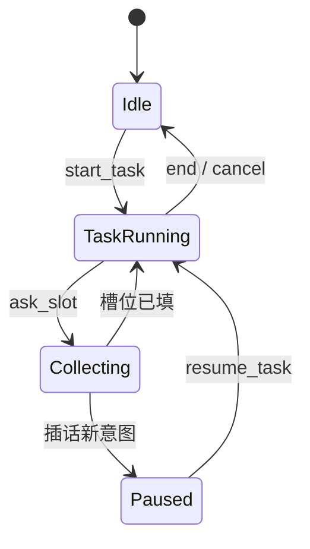

# Day 02 - 对话状态中枢：DialogueState 双轨道与任务暂停栈

---

## 1. 任务目标

### 1.1 本章目标

1. 说清 **业务任务** 与 **系统追问** 为什么要分成两条轨道；
2. 会画 `TaskContext` / `SystemContext` 的字段职责；
3. 解释插话时 `paused_tasks` 怎么压栈（恢复是 P1）。

### 1.2 涉及文件

| 文件 | 角色 |
|---|---|
| `agent_gateway/domain/messages.py` | Message / BotMessage / ProcessResult |
| `agent_gateway/domain/contexts.py` | TaskContext + SystemContext 7 子类 |
| `agent_gateway/domain/state.py` | DialogueState 聚合根 |
| `agent_gateway/repository/state_repository.py` | 状态落库 |

---

## 2. 核心概念桥接

| 术语 | 对照 | 一句话 |
|---|---|---|
| DialogueState | 会话级聚合根 | 一个用户一份 |
| TaskContext | 表单/工单草稿 | 跑到哪个流程哪一步、收了什么槽 |
| SystemContext | 系统提示/追问 | 引擎主动问「设备编号是？」 |
| paused_tasks | 操作挂起栈 | 插话时把原任务暂存 |
| pending_turn | 未提交草稿 | 半截轮次不进历史 |

---

## 3. 为什么是「双轨道」

### 3.1 场景

```text
用户：帮我报修
助手：请提供设备编号。          ← 系统在等 device_id
用户：还在保修吗？              ← 新意图插话
```

若只有一份 `intent` 状态：新意图会**吞掉**正在收集的 device_id。

### 3.2 规则

```text
优先级：current_context（系统追问） > task（业务任务）
插话：原 task → paused_tasks，先跑新意图
```



---

## 4. 字段速查

### 4.1 TaskContext

```python
@dataclass(slots=True)
class TaskContext:
    flow_id: str = ""                 # 对应 flow_config 的 flow key
    step_id: Optional[str] = None     # 当前步骤 id
    slots: dict[str, Any] = ...       # {"device_id": "DEV-2026-0001"}
```

### 4.2 SystemContext（注册表分发）

| type | 子类 | 何时出现 |
|---|---|---|
| collect | CollectSystemContext | 业务缺槽追问 |
| started | StartedSystemContext | 开新任务 |
| interrupted | InterruptedSystemContext | 插话打断 |
| resumed | ResumedSystemContext | 恢复原任务 |
| canceled | CanceledSystemContext | 用户取消 |
| cannot_handle | CannotHandleSystemContext | 引擎无法处理 |
| completed | CompletedSystemContext | 任务完成 |

序列化：`to_dict` 写入 `"type"`，`from_dict` 查 `_SYSTEM_CONTEXT_TYPES` 还原子类——**和 FlowStep 同一套多态套路**。

---

## 5. 持久化设计

```text
一行状态 = sender_id + JSON(payload)
payload = {task, current_context, paused_tasks, sessions, ...}
```

要点：

1. `from_dict` 用 `data.get(key, default)`，旧 JSON 缺字段不炸；
2. `pending_turn` 只在内存，`commit_turn` 才进 `session.turns`；
3. 会话超时 `reset_running_state_for_new_session` 清运行态、保留历史。

> **P1 缺口**：状态与消息目前分两次写库，未同事务；重启恢复尚未跑真实 MySQL 验证。讲课时说「设计如此，实现待补」。

---

## 6. 与运行时的衔接

```text
DialogueService.chat
  state = load(sender_id)
  result = handle_message(..., state=state)   # 引擎就地改 state.task
  save(state)
  return result.messages
```

**口诀**：Service 管 I/O，Engine 管计算；状态变更都落在 DialogueState 对象上。

---

## 7. 灵魂拷问

1. 为什么 `current_context` 优先级高于 `task`？
2. `slots` 里能不能存 LLM 推理原文？为什么不行？
3. 取消报修会不会删掉已创建的历史工单？
4. 若两个请求同时改同一 `sender_id` 的状态，会发生什么？（并发覆盖 → P1 要乐观锁）

### 参考答案

**1. 为什么 `current_context` 优先级高于 `task`？**  
系统刚问「设备编号是？」时，下一句应优先被理解为**对该追问的回答**，而不是新开业务。否则用户填的编号会被意图路由当成闲聊/新任务吞掉。双轨道 + 优先级保证「问了就先听答」。

**2. `slots` 能不能存 LLM 推理原文？**  
不能。`slots` 是**业务字段**（device_id、problem_type…），要入历史/落库/给中台。推理原文可能含密钥、PII、幻觉内容，体积大且不可校验。模型输出应先经 Validator 白名单再写入；链路日志单独脱敏存储。

**3. 取消报修会不会删历史工单？**  
不会。`cancel_task` 只清**当前内存任务**（task / current_context）。已持久化的历史工单在中台业务库里，取消对话 ≠ 撤销工单；要撤单是另一条「取消工单」写流程，同样要确认。

**4. 两请求同时改同一 `sender_id` 会怎样？**  
后写覆盖先写（last-write-wins），可能丢 step_id/slots 或重复消息。P1 要用乐观版本/行锁 + 一轮消息与状态同事务提交，冲突时显式失败并提示重试。
