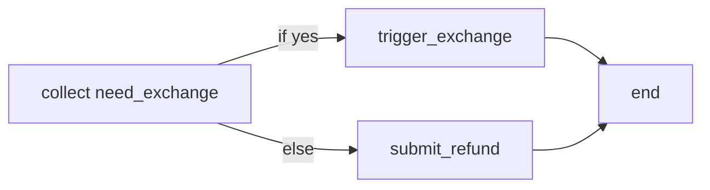
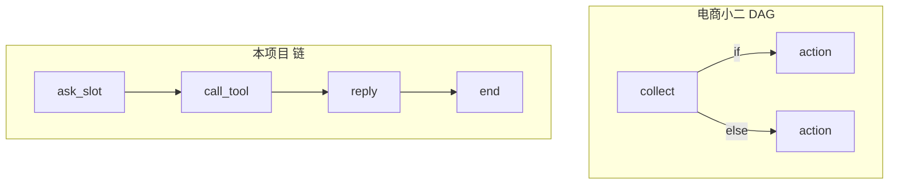

# Day 03 - YAML 流程定义：节点、边，以及「为什么我们暂时不用挂边」

> **本章回答你的核心问题**：电商小二有 `FlowStep + FlowStepLink` 的「节点挂边」DAG；DeviceCare 目前是线性 `next: step_id`。不是漏做，是刻意的阶段选择。

---

## 1. 任务目标

1. 看懂 `flow_config/*.yml` 每个字段；
2. 对照电商小二的 **节点-边 DAG**，说清本项目 **线性 next** 的差异与原因；
3. 会用 `task/models.py` 做加载校验，知道何时再升级成挂边。

### 1.2 涉及文件

| 文件 | 角色 |
|---|---|
| `flow_config/user_flows.yml` | 4 条业务流程 |
| `flow_config/system_flows.yml` | 7 条系统流程 |
| `agent_gateway/task/models.py` | FlowSlot / FlowStep 子类 / Flow / FlowCatalog |

---

## 2. 核心概念桥接

| 术语 | 电商小二 | 本项目 | 一句话 |
|---|---|---|---|
| 节点 | `FlowStep` 子类 5 种 | `FlowStep` 子类 4 种 | 流程图上的「做什么」 |
| 边 | `FlowStepLink` 3 种 | **字符串 `next`** | 「做完跳哪」 |
| 图形态 | 条件分支 DAG | **近似链表** | 见 §3 |
| 步骤类型 | start/action/collect/set_slot/end | ask_slot/call_tool/confirm/reply | 领域语义不同 |
| 加载器 | `FlowLoader.load_many` | `load_catalog()` | 启动即校验 |

---

## 3. 「节点挂边」到底是什么（必讲）

电商小二把流程拆成两类对象：

```text
节点 FlowStep  = 这一步做什么
边   FlowStepLink = 跑完这一步跳到哪（可带条件）
```

YAML 里 `next` **可以是字符串，也可以是条件列表**：

```yaml
# 电商小二：静态边
next: ask_order_number

# 电商小二：条件边 + 默认边
next:
  - if: "slots.get('need_exchange') == 'yes'"
    then: trigger_exchange
  - else: submit_refund
```

对应对象：

```python
FlowStep.next: List[FlowStepLink]

StaticLink(target="ask_order_number")
ConditionalLink(condition="...", target="trigger_exchange")
FallbackLink(target="submit_refund")
```

这样整张流程是一张 **可分支的有向图（DAG）**。



---

## 4. 本项目的选择：线性 `next`

### 4.1 现在的 YAML 长什么样

```yaml
# flow_config/user_flows.yml（节选）
check_warranty:
  entry: ask_device_id
  slots: [device_id]
  steps:
    - id: ask_device_id
      type: ask_slot
      slot: device_id
      ask: "请提供要查询的设备编号（如 DEV-2026-0001）。"
      next: query_warranty          # ← 字符串，不是 Link 列表

    - id: query_warranty
      type: call_tool
      action: check_warranty
      permission: read
      params: { device_id: "${slots.device_id}" }
      next: reply_warranty

    - id: reply_warranty
      type: reply
      say: "设备 ${slots.device_id} 的保修状态：${tool.warranty_status}…"
      next: end                     # ← 哨兵值，不是节点
```

### 4.2 对象模型（task/models.py）

```text
Flow
 ├─ flow_id / name / desc / entry / slots
 └─ steps: list[FlowStep]
      ├─ AskSlotStep   (slot_name, ask, options)
      ├─ CallToolStep  (action, permission, params, need_confirm)
      ├─ ConfirmStep   (ask)          # 写操作闸门
      └─ ReplyStep     (say, suggestions)

next: str   # 只有「下一个 step_id」或 "end"
```

**没有 `links.py`，没有 `ConditionalLink`。**

### 4.3 为什么暂时不挂边（设计决策，不是偷懒）

| 原因 | 说明 |
|---|---|
| **业务还没长出分支** | 保修/进度是直线；报修是「收槽→确认→建单」；转人工是「确认→转」。`if` 还用不上 |
| **YAGNI** | 先让 4 条流程可测跑通，比先写 DAG 求值器更重要 |
| **安全更简单** | 线性 next + 前置 ConfirmStep，比「条件边跳过 confirm」更容易审计 |
| **和 P0 范围对齐** | M0-M1 目标是可靠闭环；条件路由属于 M2 规划层 |

### 4.4 什么时候升级成挂边

出现下面任一需求，就该引入 `FlowStepLink`：

```yaml
# 例 1：按槽位分支
next:
  - if: "slots.problem_type == 'hardware_failure'"
    then: ask_error_code
  - else: confirm_create

# 例 2：按工具结果分支
next:
  - if: "tool.warranty_status_code == 'expired'"
    then: suggest_paid_repair
  - else: reply_warranty
```

升级路径（保持向后兼容）：

```text
next: "query_warranty"                    # 旧写法 → StaticLink
next: [{if: ..., then: ...}, {else: ...}] # 新写法 → Conditional + Fallback
```

`link_from_json` 用**数据形态**分发（电商小二同款），Step 用 `type` 字段分发。

---

## 5. 两种模型对照表（讲课白板）

| | 节点挂边（电商小二） | 线性 next（本项目） |
|---|---|---|
| 图形态 | 条件 DAG | 链表 + end 哨兵 |
| `next` 类型 | `List[FlowStepLink]` | `str` |
| 分支 | if / else 边 | 无（靠代码外 if） |
| 循环 | 可能（边可指回） | 理论可指回，执行器 MAX_STEPS 熔断 |
| 复杂度 | 高（求值器 + 安全 eval） | 低（`steps[step_id].next`） |
| 适合 | 多分支售后/理赔 | 4 条直线业务 + confirm |



---

## 6. 加载校验（两边一致的思想）

启动时必须炸掉坏定义，而不是跑到一半 KeyError：

| 校验 | models.py | 电商小二 |
|---|---|---|
| 步骤 type 白名单 | `_STEP_TYPES` 注册表 | `STEP_TYPE_TO_CLASS` |
| entry 落在 steps | ✓ | ✓ |
| next 可解析 | ✓（id 或 end） | ✓（解析成 Link） |
| 槽位引用存在 | ✓ | ✓ |
| write_confirm 工具 | params.confirmed 必须 True | confirm 前置 |
| 系统流程 type | 对齐 SystemContext 白名单 | 对齐 contexts |

---

## 7. 具体实现速览

### 7.1 类型分发（与 SystemContext 同一套路）

```python
_STEP_TYPES = {
    "ask_slot": AskSlotStep,
    "call_tool": CallToolStep,
    "confirm": ConfirmStep,
    "reply": ReplyStep,
}

def parse_step(data: dict) -> FlowStep:
    return FlowStep.from_dict(data)  # 基类内查 _STEP_TYPES
```

### 7.2 为什么不直接 `step["type"] == "ask_slot"`

```python
# 反例：dict 大瀑布
if step["type"] == "ask_slot":
    ...
elif step["type"] == "call_tool":
    ...  # 每加一种 type 改 N 处
```

注册表 + 子类字段 = **加一种步骤只加一个类**。

### 7.3 哨兵 `end` vs `EndStep` 节点

本项目用 `next: end` 字符串哨兵，**没有**独立 `EndStep` 节点。  
电商小二有 `EndFlowStep` 节点，图更「纯」，但多一次对象构造。  
本项目在 `FlowExecutor` 里：

```python
if task.step_id == FLOW_END:  # "end"
    finish_task(...)
```

**可讲点**：图论纯度 vs 实现简单度的取舍。

---

## 8. 灵魂拷问

1. 「节点挂边」比线性 `next` 强在哪？弱在哪？
2. 若产品要加「过保走付费、在保走免费」分支，你改 YAML 还是改 Python？要动哪几个类？
3. 为什么加载阶段就要校验 next，而不是执行时？
4. `next: end` 和 `next: [{else: end}]` 语义差在哪？
5. 条件表达式能 `eval` 用户输入吗？为什么电商小二也只 eval 受限表达式？

### 参考答案

**1. 挂边强在哪 / 弱在哪？**  
**强**：可表达条件分支、默认边、复杂 DAG，流程即图，和 BPMN/工作流同构。  
**弱**：模型与求值器更复杂（Link 多态、条件表达式安全、调试难）；线性 next 几乎零学习成本。业务无分支时挂边是过度设计。

**2. 加「过保付费 / 在保免费」改哪？**  
优先改 **YAML** + 少量模型：把 `next: str` 扩成 `str | list[{if,then},{else}]`，新增 `ConditionalLink`/`FallbackLink`（或等价 dict 解析），`FlowExecutor` 选边时求值。若仍只有字符串 next，则只能改 Python——那就是反例。

**3. 为什么加载阶段校验 next？**  
跑到一半 KeyError/步进丢失会把用户晾在半截任务里，还可能已发出错误工具调用。启动时 `validate_flow` 保证 entry 可达、next 合法、能到 end、无环/孤儿，配置错误在发布前暴露。

**4. `next: end` 与 `next: [{else: end}]`？**  
前者是**无条件**终边（哨兵字符串）。后者是**条件边列表**：默认分支指向 end；若有 if 命中则走 then。语义上一个是「一定结束」，一个是「默认结束、可能改道」。

**5. 能否 eval 用户输入？**  
绝对不行——等于远程代码执行。条件表达式只能作用于**内部** `slots`/`tool` 白名单字段，且用受限求值器（或自写比较），绝不对用户原文 `eval`。电商小二也只 eval 配置里的受限表达式，且禁止任意调用。

---

## 9. 动手任务

1. 打印 `load_catalog()` 后 `check_warranty` 的 `step_map()`，对照 YAML；
2. 故意把某步 `next` 改成不存在的 id，看 `ValueError` 信息；
3. （选做）为 `next` 写一个 `parse_link` 原型，支持字符串 + `{if,then}`，并让旧 YAML 继续可加载。
