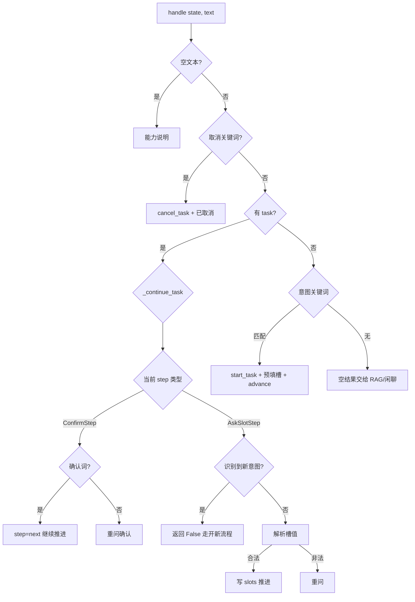

# Day 04 - FlowExecutor：谁在推状态机，工具怎么调

---

## 1. 任务目标

1. 会画一轮消息在 `FlowExecutor.handle` 里的分支；
2. 说清收槽 / 确认 / 调工具 / 模板回复四类步骤的处理；
3. 知道插话压栈、取消、工具失败时状态怎么变。

### 1.2 涉及文件

| 文件 | 角色 |
|---|---|
| `agent_gateway/engine/flow_executor.py` | 流程推进 |
| `agent_gateway/task/tools.py` | ToolRegistry + 4 个工具 |
| `agent_gateway/engine/stub_brain.py` | 入口：流程优先，RAG/能力说明兜底 |
| `agent_gateway/test/test_flow_executor.py` | 多轮回归 |

---

## 2. 核心概念桥接

| 术语 | 对照 | 一句话 |
|---|---|---|
| FlowExecutor | DAG 调度器 / 解释器 | 按 step_id 推进 |
| ToolRegistry | 防腐层 | 固定端点调中台 |
| ProcessResult | 出参 DTO | messages + task_status |
| 模板 `${slots.x}` / `${tool.x}` | 视图渲染 | 禁止 eval |
| MAX_STEPS | 熔断 | 防 YAML 写错死循环 |

---

## 2.5 对话全流程示意图（文件 × 函数）

```mermaid
flowchart TB
  subgraph FE [前端 device-service-frontend/App.vue]
    UI1[sendTextMessage / sendPayload]
    UI2[appendBotMessages 渲染]
  end

  subgraph API [agent_gateway/api]
    R[routers.chat]
    S[schemas.ChatRequest / ChatResponse]
  end

  subgraph SVC [service]
    D[dialogue_service.chat]
    REPO[state_repository load/save]
  end

  subgraph ENG [engine]
    H[stub_brain.handle_message]
    FE2[flow_executor.handle]
    ADV[_advance / _handle_confirm / _fill_slot]
  end

  subgraph TOOLS [task/tools.py]
    TR[ToolRegistry.call]
    OWN[_ensure_device_owned]
  end

  subgraph MID [中台 :18082]
    MW[/devices/*/warranty]
  end

  UI1 --> R
  R --> S
  R --> D
  D --> REPO
  D --> H
  H --> FE2
  FE2 --> ADV
  ADV --> TR
  TR --> OWN
  TR --> MW
  D --> R
  R --> UI2
```

### 函数职责地图（谁管什么）

| 文件 | 函数 | 职责 |
|---|---|---|
| `api/routers.py` | `chat()` | HTTP 入口，校验 body，调 service，回 ChatResponse |
| `api/schemas.py` | `ChatRequest/ChatResponse` | 出入参协议，不写业务 |
| `service/dialogue_service.py` | `chat()` | **事务边界**：load state → process → save |
| `service/dialogue_service.py` | `_load/_save` | 仓储读写 DialogueState |
| `engine/stub_brain.py` | `handle_message` | 分流：流程优先，RAG/能力说明兜底 |
| `engine/flow_executor.py` | `handle` | 取消 / 续任务 / 开新流程 / 插话 |
| `engine/flow_executor.py` | `_continue_task` | 确认步、收槽步续跑 |
| `engine/flow_executor.py` | `_handle_confirm` | 是的→推进；取消；闲聊澄清 |
| `engine/flow_executor.py` | `_fill_slot` | 解析槽值并写 TaskContext.slots |
| `engine/flow_executor.py` | `_advance` | 状态机：ask/confirm/tool/reply 到 end |
| `engine/flow_executor.py` | `_run_tool` | 渲染 params、注入 customer_id、调工具 |
| `engine/flow_executor.py` | `_detect_flow_id` | 关键词 → flow_id（意图） |
| `engine/flow_executor.py` | `_is_confirm/_is_cancel` | 口语确认/取消判断 |
| `task/tools.py` | `ToolRegistry.call` | action 白名单分发 |
| `task/tools.py` | `_check_warranty` 等 | 固定 HTTP + 字段归一 |
| `task/tools.py` | `_ensure_device_owned` | 设备归属预检 |
| `task/models.py` | `load_catalog/validate_flow` | YAML→对象 + 启动校验 |
| `domain/state.py` | `DialogueState.*` | task / paused_tasks 生命周期 |
| `domain/contexts.py` | `TaskContext` | flow_id + step_id + slots |
| `domain/messages.py` | `MessageType/Message` | 消息类型与序列化 |

### 类型判断在哪

| 判断什么 | 函数 | 文件 |
|---|---|---|
| text / object / divider | `MessageType.from_value` | `domain/messages.py` |
| 用户意图（保修/转人工） | `_detect_flow_id` | `engine/flow_executor.py` |
| 同意 / 放弃 | `_is_confirm` / `_is_cancel` | `engine/flow_executor.py` |

---

## 3. 一轮输入的决策树



---

## 4. 推进算法（_advance）

```text
loop 最多 MAX_STEPS:
  step_id == end     → finish_task（state.end_task）
  AskSlotStep        → 槽已有值 ? 跳 next : 追问并 return
  ConfirmStep        → 追问确认并 return
  CallToolStep       → tools.call；失败 return；成功写入 _tool_data
  ReplyStep          → 渲染 say 后跳 next
```

要点：

1. **只有 ask / confirm 会停下来等用户**；
2. 工具结果放本轮 `_tool_data`，供 `${tool.xxx}`；
3. 流程结束 `state.end_task()`，`TaskContext` 清空。

---

## 5. 工具层契约

```python
async def call(step: CallToolStep, params: dict) -> ToolResult:
    # 只认 step.action 白名单，不接受 YAML 写 URL
```

| action | HTTP | 权限 |
|---|---|---|
| check_warranty | GET /devices/{id}/warranty | read |
| get_repair_progress | GET /tickets/{id}/repair | read |
| create_service_ticket | POST /devices/{id}/tickets | write_confirm |
| transfer_to_human | POST /transfers | write_confirm |

字段归一：中台 `warranty_deadline` → 模板 `${tool.warranty_deadline}`；状态码映射为中文 `warranty_status`。

**安全**：`write_confirm` 在模型层强制 `need_confirm`；真正「用户已同意」必须中台服务端确认令牌（P1，见台账）。

---

## 6. 多轮示例（测试同款）

```text
U: 帮我查保修
A: 请提供要查询的设备编号（如 DEV-2026-0001）。     # 0 次 HTTP
U: DEV-2026-0001
A: 设备 DEV-2026-0001 的保修状态：在保修期内，有效期至 2027-02-15。
   # 调用 1 次 GET .../warranty，然后 task 清空
```

```text
U: 帮我查保修
A: 请提供设备编号…
U: 转人工                    # 新意图，不当槽值
A: 确定要转接人工客服吗？     # 进入 transfer confirm
   # 原 check_warranty 压入 paused_tasks
```

---

## 7. 设计决策

| 决策 | 原因 |
|---|---|
| 执行器不拼 URL | 防注入 / 可测 |
| 模板只替换命名空间 | 禁止 `eval(f"...")` |
| 收槽前先识别新意图 | 避免「转人工」被吃成 device_id |
| 工具失败不伪造结果 | 信任边界 |
| 目录进程内缓存 | 少读盘；测试可注入 catalog |

---

## 8. 与电商小二 FlowExecutor 的差异

| | 电商小二 | 本项目 P0 |
|---|---|---|
| 边求值 | ConditionalLink + 受限 eval | 无，字符串 next |
| Action | ActionRunner 注册表 + 自动发现 | ToolRegistry 4 个固定函数 |
| 系统流程 | 7 个 system_flows 完整跑 | YAML 有，执行器只用业务流 + 取消话术 |
| 双层熔断 | 内 250 / 外 1000 | 单层 MAX_STEPS=30 |
| 恢复 | resume 完整 | 压栈有，弹回 P1 |

---

## 9. 灵魂拷问

1. 为什么「空文本」和「认不出意图」返回不同结果？
2. `_tool_data` 为什么不写进 `TaskContext.slots`？
3. 若 YAML 两步互相 `next` 会怎样？谁兜底？
4. confirm 步用户说「随便」，系统该做什么？
5. 如何证明「缺设备编号时零 HTTP 调用」？

### 参考答案

**1. 空文本 vs 认不出意图？**  
空输入是用户没说话，应给能力提示。认不出意图则**交回上层**（RAG/闲聊），`FlowExecutor` 返回空 `messages`，避免流程层抢答知识问答。两者路由出口不同。

**2. `_tool_data` 为何不进 `slots`？**  
`slots` 是用户收集的业务字段，要持久化并给中台；工具结果是**本轮执行临时数据**（`${tool.warranty_status}`），会过期、可能含接口细节。混进 slots 会污染任务快照与审计。

**3. 两步互相 `next` 谁兜底？**  
加载期 `validate_flow` 会报「next 环 / 无法到达 end」。若漏网，执行器 `MAX_STEPS` 熔断并 `end_task`，提示重新发起——双层防护。

**4. confirm 用户说「随便」？**  
不能当确认。只有明确确认词（确认/确定/可以）才进 next；否则**重问**确认句。取消词走 cancel。写操作绝不能「默认通过」。

**5. 如何证明缺设备编号零 HTTP？**  
单测里 FakeDeviceClient 记录 `calls`：第一轮 `assert device.calls == []`，第二轮 `assert calls == ["/devices/DEV-.../warranty"]`。见 `test_flow_executor.py` / `test_dialogue_service_state.py`。

---

## 10. 动手任务

1. 跑 `pytest atgui_agent/agent_gateway/test/test_flow_executor.py -q`，读失败信息怎么改；
2. 给 `get_repair_progress` 写一条多轮测试（缺工单号 → 填号 → 查询）；
3. 把 `MAX_STEPS` 改成 2，观察熔断话术。
