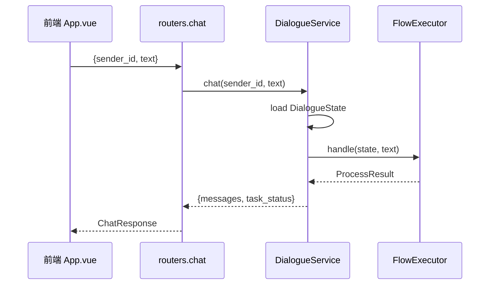

# Day 05 - API 边界与前后端联调：协议转换、状态落库、前端能测什么

---

## 1. 任务目标

### 1.1 本章目标

1. 说清 **HTTP 层只做协议转换**，业务全在 service/engine；
2. 会对照 `ChatRequest` / `ChatResponse` 与领域模型 `Message` / `DialogueState`；
3. 知道前端联调测什么、怎么起服务、哪些现象不是 bug。

### 1.2 涉及文件

| 文件 | 角色 |
|---|---|
| `agent_gateway/api/app.py` | FastAPI 装配、CORS、lifespan |
| `agent_gateway/api/routers.py` | `/health` `/api/chat` `/api/chat/history` |
| `agent_gateway/api/schemas.py` | 出入参 Pydantic 模型 |
| `agent_gateway/service/dialogue_service.py` | load → process → save |
| `device-service-frontend/src/App.vue` | 工作台 UI |
| `test/test_api_chat.py` | 契约与降级测试 |

---

## 2. 核心概念桥接

| 术语 | 后端对照 | 一句话 |
|---|---|---|
| ChatRequest | DTO / 请求体 | 前端发来的信封 |
| ChatResponse | DTO / 响应体 | 前端要渲染的 messages |
| Message | 领域消息 | 可落库、可还原 |
| DialogueService | Application Service | 一轮对话的事务边界 |
| FastAPI 路由 | Controller | 不写业务决策 |

---

## 3. 一条请求的三步（必记）

```text
POST /api/chat
  ① 处理输入接口模型   ChatRequest → Message.user_text
  ② 业务处理           handle_message(..., state) / FlowExecutor
  ③ 处理输出接口模型   ProcessResult / Message → ChatResponse
```



**为什么 API 不直接查库/拼 SQL**：协议会变，业务规则要可单测、可替换。

---

## 4. 出入参字段（与前端对齐）

### 4.1 请求

```python
class ChatRequest(BaseModel):
    sender_id: str          # 演示身份，不可当生产鉴权
    text: Optional[str]
    object: Optional[dict]  # 设备/工单卡片
    # message_id：P1 再加（幂等 / 追溯），见 §7
```

### 4.2 响应

```json
{
  "messages": [
    {"role":"bot","type":"text","text":"…","suggestions":["查保修"],"images":["http://…jpg"]}
  ],
  "task_status": "check_warranty"
}
```

| 字段 | 用途 |
|---|---|
| `role` | user / bot / divider |
| `type` | text / object / divider |
| `images` | RAG 手册截图，前端渲染缩略图 |
| `object` | 设备/工单卡片 |

---

## 5. DialogueService：真正的事务边界

```python
# 1. 为什么必须先 load：收槽/插话依赖上次 task/step_id
state = self._load(sender_id)
# 2. 用户消息入历史
user_msg = Message.user_text(text)
# 3. 业务处理：state 交给引擎，不是只读不用
result = handle_message(text, sender_id, device_client, state=state)
# 4. 出参模型
# 5. 持久化消息 + 状态（P1 应同事务）
```

要点：

1. **Service 管 I/O，Engine 管计算**；
2. `state` 必须传进 `handle_message`，否则多轮收槽断掉；
3. 消息与状态目前分步写，P1 收成同一事务 + 乐观版本。

---

## 6. 前端联调（截止 FlowExecutor）

### 6.1 起服务

```powershell
# 中台 + MySQL
cd F:\AAA求职相关\device_agent\atgui_agent
docker compose up --build

# Agent（另开；注意 Windows 跨盘 cd /d）
cd /d F:\AAA求职相关\device_agent
.\.venv\Scripts\python.exe -m uvicorn agent_gateway.api.app:app --port 8100

# 前端（另开）
cd /d F:\AAA求职相关\device_agent\atgui_agent\device-service-frontend
npm run dev
```

### 6.2 可测清单

| 类型 | 场景 |
|---|---|
| ✅ 流程 | 查保修多轮、一句话带编号、不查了取消、是的确认转人工 |
| ✅ 语义 | 归属外设备拒答、确认态闲聊澄清 |
| ✅ 展示 | RAG 缩略图、建议词、历史、设备卡片 |
| ⛔ 未完 | 服务端确认凭证、写单幂等、插话恢复、LLM 规划 |

### 6.3 常见坑

| 现象 | 原因 |
|---|---|
| `npm` 找不到 package.json | cmd 跨盘要用 `cd /d` |
| 改了语义词表仍旧行为 | Agent 进程没重启 |
| 侧栏设备为空 | 中台未起或 `sender_id` 不是 u1001 |
| RAG 全是 URL | 旧消息；新查询应出缩略图 |

---

## 7. message_id（P1 预留）

电商小二 `ChatRequest` 含 `message_id`。本项目计划同款：

1. 防重：同 `sender_id + message_id` 幂等；
2. 追溯：用户句 ↔ bot 句 ↔ 工具调用；
3. 与 `Turn.turn_id`、`confirmation_id` 一起做写安全。

**现在不加也不挡联调**，和写闸门一起进 P1。

---

## 8. 灵魂拷问

1. 为什么路由里不写「查保修」业务？
2. `task_status` 返回的是 flow_id 还是对话状态机状态？
3. 前端 `sender_id` 能改，测归属有什么意义？
4. history 为什么要能还原 `images` / `object`？
5. 如何证明 `DialogueService` 真的把 state 交给了引擎？

### 参考答案

**1. 为什么不写在路由里？**  
路由只做协议转换，便于换传输层、做鉴权中间件、单测 Service。业务在 FlowExecutor/Service，改流程不动 HTTP 契约。

**2. `task_status` 是什么？**  
当前是 `state.task.flow_id`（在跑哪个业务流），不是「COLLECTING_SLOTS」这种步骤态；步骤在 `TaskContext.step_id`。出参可按前端需要再映射。

**3. 改 sender_id 测归属有意义吗？**  
演示层有意义：展示「不是你的设备不应答」。但**不能**当安全证明——生产必须服务端身份 + 中台资源鉴权。

**4. history 要带 images/object？**  
刷新后不能丢图、丢卡片，否则用户以为内容丢了；序列化 `Message.to_dict` 必须覆盖全部展示字段。

**5. 怎么证明 state 真被使用？**  
集成测试：第一轮仓储里有 `task.step_id`，第二轮从仓储还原后继续收槽并只调一次工具。见 `test_dialogue_service_state.py`。

---

## 9. 动手任务

1. 用 curl 连打两轮保修，对比 `task_status` 变化；  
2. 读 `routers.py`，标出 ①②③ 分别在哪几行；  
3. 给 `/api/chat` 增加可选 `message_id`（先透传不处理），为 P1 幂等做准备。
