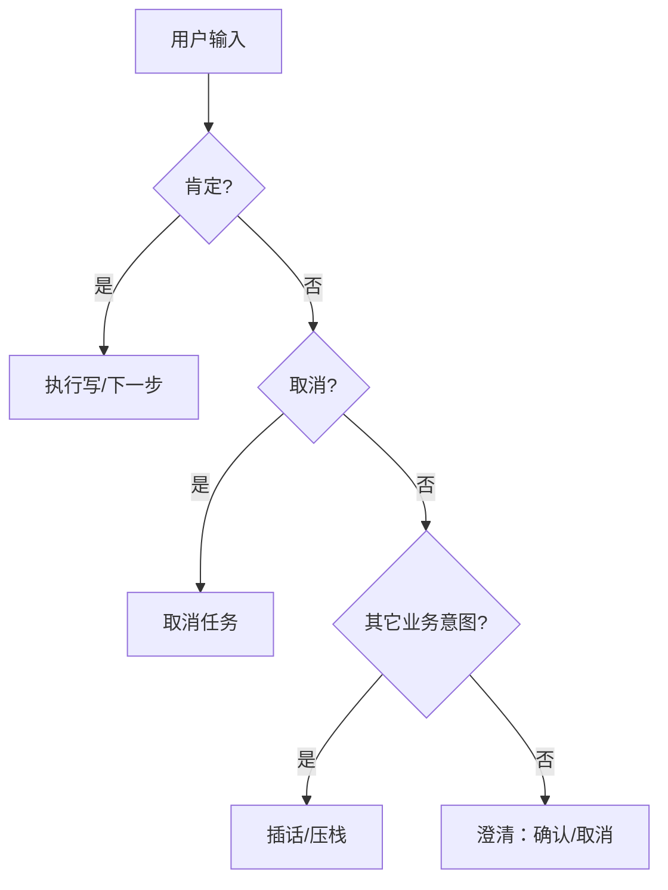

# Day 06 - 语义理解与安全闸门：口语确认/取消、资源归属、写操作边界

---

## 1. 任务目标

### 1.1 本章目标

1. 说清 **规则语义**（M1）与 **LLM 规划**（M2）的分工；
2. 会解释为什么「不查了 / 是的 / 今天天气」在 confirm 态行为不同；
3. 分清 **Agent 归属预检** 与 **中台资源级鉴权**，以及 `params.confirmed` 不是用户授权。

### 1.2 涉及文件

| 文件 | 角色 |
|---|---|
| `engine/flow_executor.py` | 确认/取消词表、confirm 澄清、插话 |
| `task/tools.py` | 设备/工单归属校验 |
| `api/schemas.py` | 请求字段（未来 message_id） |
| 中台 `device-service-backend/app/api.py` | 业务事实与写入（鉴权未完） |
| `test/test_flow_executor.py` | 语义与归属用例 |

---

## 2. 核心概念桥接

| 术语 | 对照 | 一句话 |
|---|---|---|
| 意图路由 | 策略表 / 网关 | 关键词 → flow_id |
| 确认态 | 状态机 WAITING | 写操作闸门 |
| 归属校验 | 数据权限 | 这台设备是不是你的 |
| 确认凭证 | 一次性 ticket | 服务端签发的「允许写」 |
| 幂等键 | 去重令牌 | 重试不重复建单 |

---

## 3. 语义规则（M1 确定性）

### 3.1 词表策略

```text
确认：是 / 是的 / 嗯 / 好的 / 行 / 对 / 确认 / 确定 / 没问题…
取消：取消 / 算了 / 不查了 / 不用了 / 不转了 / 不想查…
```

**为什么短词要整句精确匹配**：`是` 做子串会命中「是否 / 但是」；`可以` 会命中「可以帮我报修吗」——那是提问不是同意。

### 3.2 confirm 态分支



| 输入 | 行为 | 为什么 |
|---|---|---|
| 是的 | 通过 | 口语肯定 |
| 不转了 | 取消 | 放弃当前确认 |
| 查保修 | 插话 | 新业务，不当同意 |
| 今天天气 | 澄清 | **绝不**默认确认写操作 |

### 3.3 收槽态

| 输入 | 行为 |
|---|---|
| DEV-2026-0001 | 填 device_id |
| 不查了 | 取消（不是槽值） |
| 转人工 | 新意图插话 |
| abc | 重问（格式不对） |

---

## 4. 资源归属：Agent 预检 vs 中台鉴权

```text
① 会话身份（token）        ✗ P1
② Agent 工具前归属预检      ✅ 已做（拉 /customers/{id}/devices）
③ 中台每个 API 资源鉴权     ✗ P1（curl 仍可绕过 Agent）
④ 写操作 confirmation_id    ✗ P1
```

工具层实现要点：

```python
# 1. 校验 device_id
# 2. 为什么先归属：中台 warranty 接口本身不校验客户
denied = await _ensure_device_owned(client, customer_id, device_id)
# 3. 查询 + 字段归一
```

**演示意义**：用户问别人的设备不应给事实。  
**安全意义**：仍不足——直接打中台 `/devices/{id}/warranty` 仍可能成功。

---

## 5. `params.confirmed` 不是授权

| 层级 | 含义 | 现状 |
|---|---|---|
| YAML `confirm` 步骤 | 流程要求用户明确同意 | ✅ |
| `params.confirmed: true` | 配置/透传字段 | ✅ 仅字段 |
| 服务端 confirmation_id | 绑会话+资源+参数摘要+TTL | ✗ P1 |
| 幂等键 + 唯一工单号 | 防双击/重放 | ✗ P1 |

> 讲课口诀：**YAML 的 true 只是「流程设计假定已确认」，不是用户点过「是」。**

---

## 6. 与 M2 LLM 规划的边界

```text
M1（现在）：关键词 + 词表 + 流程引擎     → 可测、可演示
M2（以后）：TurnPlan JSON + Validator   → 灵活、仍要白名单
```

M2 约束（现在就该想清）：

1. 模型只出 `route / flow_id / slots`，**不给**任意工具名、URL、`confirmed`；
2. 解析失败 → 澄清或回退关键词，不猜着写；
3. 评测集要有「提示注入 / 诱导确认 / 他人设备」负例。

---

## 7. 灵魂拷问

1. 为什么确认不能用「默认同意」？
2. 「是」为什么不能 `in text` 匹配？
3. Agent 挡住了 0003，是否等于系统安全？
4. 闲聊应重问还是打断确认？
5. 加入 LLM 后，词表/流程引擎还需要吗？

### 参考答案

**1. 为何不能默认同意？**  
写操作（建单、转人工）有真实副作用。宁可多一轮澄清，也不能把「嗯…」「好吧我看看」当成授权。

**2. 为何不用子串匹配「是」？**  
「是否在保修」「但是」都会误判为确认。短词必须整句精确匹配，长词才用包含。

**3. Agent 挡住 0003 等于安全吗？**  
不等于。那是体验层预检；绕过 Agent 直接调中台仍可能读到资源。必须中台基于**可信身份**做资源鉴权。

**4. 闲聊：重问还是打断？**  
当前策略：**澄清**（附「确认/取消」按钮），不自动通过；若是明确业务意图则插话。产品上也可选「超时后自动取消确认」。

**5. 有了 LLM 还要不要规则？**  
要。词表/流程是安全与确定性底座；LLM 负责理解与填槽草稿，输出必须过 Validator 白名单，失败回退规则。

---

## 8. 动手任务

1. 列 10 句口语，标「确认 / 取消 / 槽值 / 新意图 / 闲聊」；  
2. 用 u1001 查 DEV-2026-0003，再 curl 中台同一接口，对比结果并写进验收记录；  
3. 设计 `confirmation_id` 字段表（principal、action、resource_id、payload_hash、expire_at）。
